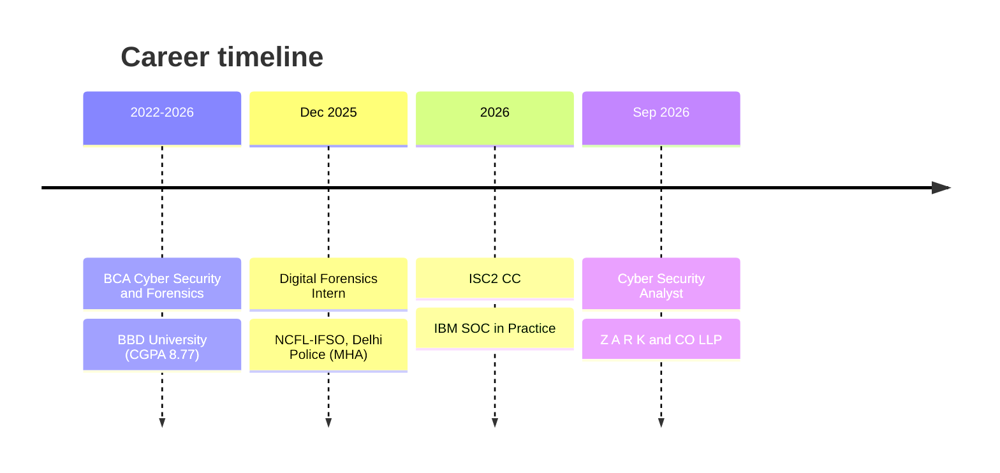

<!--
SETUP
1. Create a PUBLIC repo named exactly your GitHub username (e.g. github.com/raunak/raunak).
2. Upload everything from this folder: README.md, assets/, .github/
3. Replace YOUR_USERNAME and YOUR-LINKEDIN-URL below (search the file).
4. Repo > Actions tab > run "Generate contribution snake" once (enables the snake animation).
-->

<p align="center">
  
</p>

<p align="center">
  <a href="YOUR-LINKEDIN-URL"></a>
  <a href="mailto:shahiraunak8@gmail.com"></a>
  
  
</p>

<br/>

## `whoami`

```console
raunak@secure:~$ cat profile.txt
name       : Raunak Raj
roles      : Cyber Security Analyst | Security Auditor | Software Developer
focus      : IS/IT audits, VAPT, DFIR, SOC, secure web apps
compliance : RBI · NABARD · CERT-In · ISO 27001
previously : Digital Forensics Intern @ NCFL-IFSO (Delhi Police, MHA)
building   : NebulaX (AI pentest platform) · WinLive Forensic Suite
status     : open to collaborate on security tooling & research
```

<br/>

## ⚡ What I Do

<table>
<tr>
<td width="25%" align="center"><h3>🏦<br/>Security Audits</h3>IS/IT audits, risk assessment and gap analysis for banks against RBI, NABARD and ISO 27001</td>
<td width="25%" align="center"><h3>🎯<br/>VAPT</h3>Web, network and infrastructure testing with OWASP methodology and CVSS-based risk scoring</td>
<td width="25%" align="center"><h3>🧬<br/>Digital Forensics</h3>Live memory acquisition, registry and browser artifacts, chain-of-custody documentation</td>
<td width="25%" align="center"><h3>💻<br/>Development</h3>MERN and Next.js apps, Python tooling, security automation and website redesigns</td>
</tr>
</table>

<br/>

## 🧰 Tech Stack

<p align="center">
  
</p>

<p align="center">
  
</p>

<br/>

## 🚀 Featured Projects

<table>
<tr>
<td width="50%" valign="top">

### 🌌 NebulaX
**AI-powered penetration testing platform**

Consolidates recon, vulnerability assessment and reporting into one workflow.

- OSINT, Nmap and OWASP ZAP integration
- Threat intel via VirusTotal, AbuseIPDB and NIST NVD
- Automated PDF reports with CVSS prioritization

`MongoDB` `Express` `React` `Node.js`

<!-- Add: [**View repo →**](https://github.com/YOUR_USERNAME/NebulaX) -->

</td>
<td width="50%" valign="top">

### 🧪 WinLive Forensic Suite
**Live forensic acquisition, automated**

A GUI tool so investigators can acquire evidence without manual command-line steps.

- Memory, registry, browser and system artifacts
- WinPmem RAM acquisition, Volatility-compatible
- About 70% less evidence prep time

`Python` `PySide6` `WinPmem` `Volatility`

<!-- Add: [**View repo →**](https://github.com/YOUR_USERNAME/WLFS) -->

</td>
</tr>
</table>

<br/>

## 🛤️ Journey



<br/>

## 🏆 Certifications and Recognition

| | |
|---|---|
| 🛡️ **ISC2** | Certified in Cybersecurity (CC) |
| 🎓 **IBM** | SOC in Practice · Fundamentals of AI · Cyber Security and Forensics |
| 🏅 **NCFL-IFSO, Delhi Police** | Letter of Appreciation |
| 🥇 **Digipodium** | Best Excellence Award |

<br/>

## 🐍 Contribution Snake

<p align="center">
  <picture>
    <source media="(prefers-color-scheme: dark)" srcset="https://raw.githubusercontent.com/YOUR_USERNAME/YOUR_USERNAME/output/snake-dark.svg"/>
    
  </picture>
</p>

<br/>

<p align="center">
  
</p>

<p align="center"><i>"Security is not a product, it's a process."</i></p>
